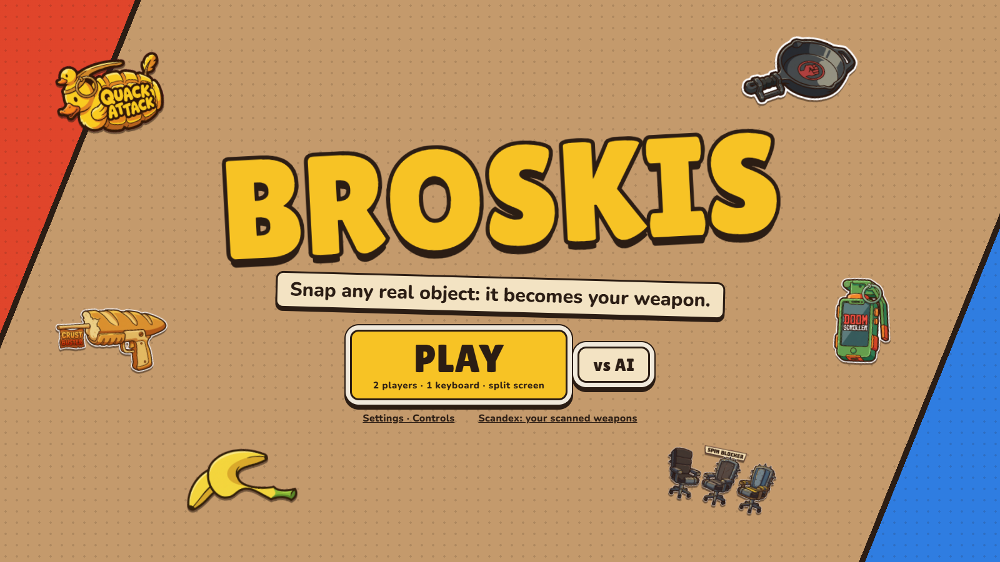
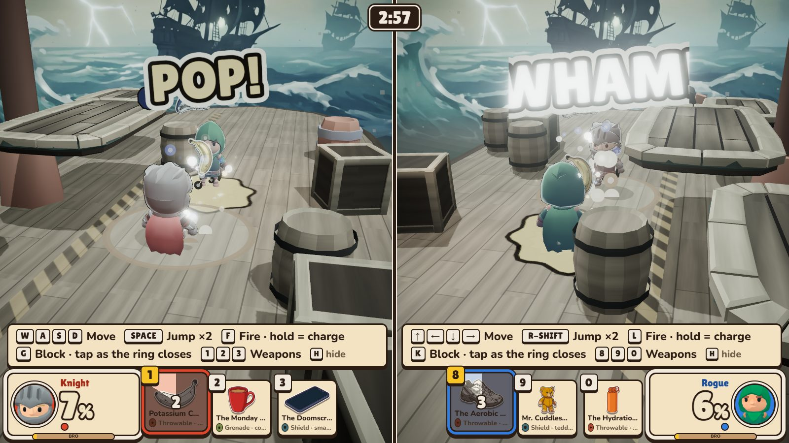
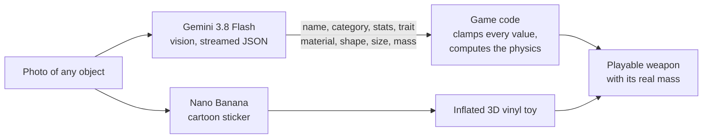
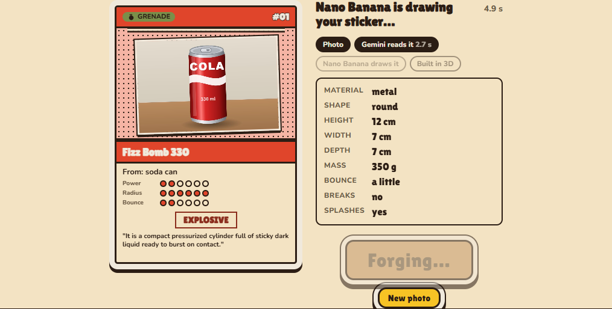
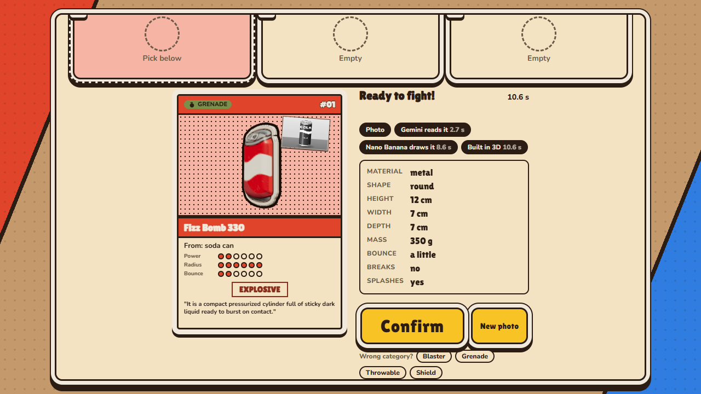
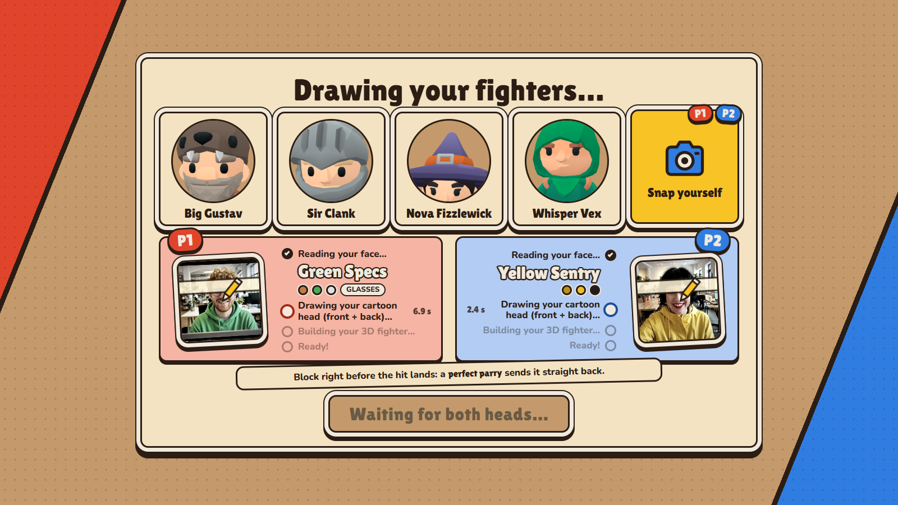
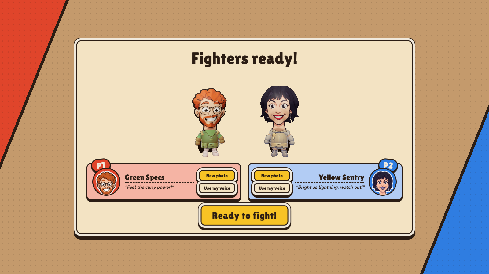
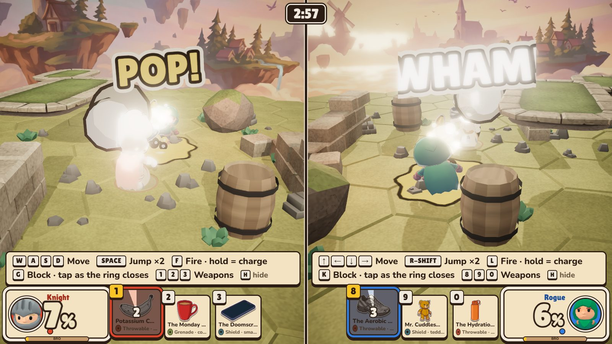
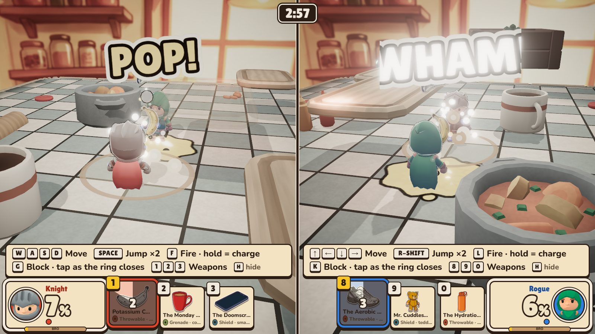
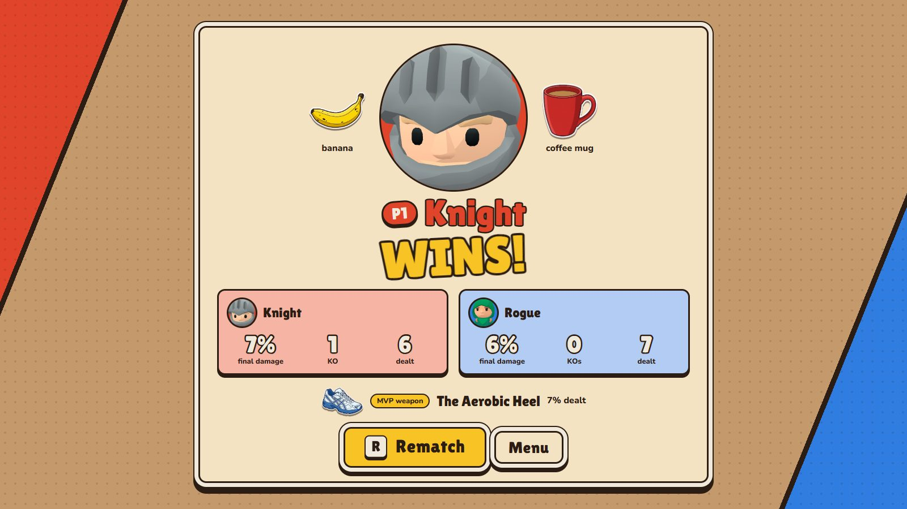

<p align="center">
  
</p>

<h1 align="center">BROSKIS</h1>

<p align="center">
  <b>Snap any real object. It becomes your weapon.</b><br>
  Snap your face. You become the fighter.<br>
  Then knock your bro off the arena: split screen, one keyboard, real time.
</p>

---

## The pitch in 10 seconds

Grab whatever is on your desk (a mug, a chair, your phone) and snap it. Ten seconds later it's a weapon in your hands, **and it behaves like the real thing**: the office chair is heavy, slow and brutal, while the soda can is light, fast and splashes. Snap your face and your own goofy 3D head joins the fight. Then it's you against your friend, Smash-style: the more damage you take, the further you fly, and the last one standing on the floating arena wins.

No two matches are the same, because **your arsenal is the real world**.

<p align="center">
  
</p>

## Why it can't exist without AI

Every weapon is **invented live** from a photo nobody could have prepared for. Two models work together, and the game code keeps the last word:



**The AI interprets, the code arbitrates.** Gemini says what the object is and estimates its material, size and mass. The game turns that into damage, knockback, throw speed, range and cooldown, all clamped by code, so no photo and no prompt can break the balance.

### A chair is not a can: measured in a real match

Numbers from our automated end-to-end test, which plays the real game with real photos:

| | Office chair | Soda can |
|---|---|---|
| Mass (estimated from the photo) | 10.5 kg | 0.35 kg |
| Damage | **32 %** | 11 % |
| Knockback | **3.5 m/s** | 1.4 m/s |
| Throw speed | 11.7 m/s | **19.7 m/s** |
| Range | 12.4 m | **69 m** |
| Cooldown | 7.2 s | **3.6 s** |
| Size in hand | 1.12 m | 0.74 m |

And the physics goes further: **glass, phones, lamps and watches shatter** on impact, **liquids splash** and leave a slippery puddle, and **bouncy things bounce**. All 10 real objects we tested (mug, chair, marker, phone, loafer, stool, Newton's cradle, lamp, chess king, watch) were thrown in a match with their own mass.

## Features (all of them work, today)

### Snap any object: a weapon in ~10 seconds, built live before your eyes

- Gemini reads the photo and the weapon card **fills in live, field by field**: name, category (Blaster, Grenade, Throwable or Shield), stats, trait, a one-liner, and the physics.
- Nano Banana redraws the object as a cartoon sticker, and the game **inflates it into a 3D vinyl toy** that spins on the card.
- Each step is timed on screen (soda can: Gemini 2.7 s, drawing 8.6 s, 3D ready 10.6 s). **Confirm only unlocks once the 3D object exists**, so nobody ever fights with a half-built weapon.
- Wrong category? One tap re-forges it. If the AI fails, the player chooses between Retry and a default weapon; the game never decides for them.
- **The object you snapped is the object you hold and throw**, scaled from its real size.

<p align="center">
  
  
</p>

### Snap your face: you are the fighter

- Gemini reads your face and **writes your nickname live**, with your colours and features.
- Nano Banana draws your **cartoon head, front and back**. The game puts it on a 3D body as a big goofy head, with your real hair and no hats.
- Both players snap **in parallel**. The waiting screen shows each real step, and "Ready to fight!" only unlocks once **your** head is on **your** fighter.

<p align="center">
  
  
</p>

### A real-time brawl, split screen, one keyboard

- **1 vs 1 in real time**, third person, lock-on aim, no mouse. Each player keeps their own half of the screen, and gamepads work too.
- **Smash rules**: damage in %, knockback that grows with it, ring-outs, 2 lives each, double jump.
- **Hold to charge**. Block, or land a **perfect parry** in the last 150 ms as the ring closes.
- **Open edges**: run off the arena and you fall. Ring-outs are the whole game.
- **Every weapon in the HUD is the object you snapped**: its sticker, its real name, its cooldown ring.

### Three arenas, built like fighting-game stages

- **The Archipelago** — a hexagon island floating over a sea of clouds, castles and windmills painted on the horizon.
- **The Galleon** — a pirate deck in the storm, a ghost fleet and lightning behind you.
- **The Giant Kitchen** — you fight on a countertop the size of a room: cutting boards, a stew pot, ketchup bottles.
- Each arena has **cover that blocks the line of fire**, a **3-platform aerial route** reachable with the double jump, and props that **react when hit** (barrels squash and wobble, platforms dip when you land).
- Painted 360° backdrops generated with Gemini's image model, so the scenery costs almost nothing to render.

<p align="center">
  
  
</p>

### An AI announcer who knows your weapons

- A ring announcer, written by Gemini and voiced by Gemini TTS (voice *Fenrir*), **comments on your hits with your actual weapons**. Live example: *"Incoming corporate discipline in aerodynamic cylinder form!"*
- The fighters shout with **Gradium** voices.
- A light, upbeat soundtrack that **ducks under every voice line**, so you always hear the announcer.

<p align="center">
  
</p>

The end screen shows **the real objects that won the match**, and the MVP weapon.

### Playing solo? Gemini coaches the bot

- A bot with real-time reflexes, and **Gemini as its strategist**: every 8 s, Gemini reads the duel and picks the bot's stance (aggressive, defensive, edge-guard or bait), its weapon and a taunt.
- Measured over simulated matches, the Medium bot wins 50 % against a simulated human player. If Gemini is slow (over 2 s), the bot keeps fighting on its last plan.

### Built for the jury's laptops

- **~72 fps in split screen** on all 3 arenas (laptop RTX GPU). Shaders are compiled before the fight, so there are no freezes mid-combat.

## Controls

| | Player 1 | Player 2 |
|---|---|---|
| Move | W A S D (Z Q S D on AZERTY) | Arrow keys |
| Jump (×2) | Space | Right Shift |
| Fire (hold to charge) | F | L |
| Block / perfect parry | G | K |
| Switch weapon | 1 · 2 · 3 | 8 · 9 · 0 |

All keys can be rebound for both players in **Settings · Controls**.

## Run it

Requires Node.js 22.12+ (or 20.19+) and a Gemini API key with billing enabled (image models have no free tier).

```bash
npm ci
cp .env.example .env
```

Put `GEMINI_API_KEY` (and `GRADIUM_API_KEY` for the fighters' voices) in `.env`. Keys stay on the local server and are never sent to the browser.

```bash
npm run demo
```

Then open http://localhost:4173 (add `?demo=1` for the stage demo: fixed seed, cached AI answers if the network drops). On a laptop, run Chrome on the dedicated GPU (Windows Settings → Display → Graphics → Chrome → High performance).

## Under the hood

Three.js · TypeScript · Vite · Rapier physics · **Gemini 3.8 Flash** (vision, streamed JSON) · **Nano Banana** (Gemini image models) · **Gemini 3.1 Pro** (announcer lines) · **Gemini TTS** · **Gradium TTS** · Playwright end-to-end tests that play the real game with real photos.

## Credits

Music by **Kevin MacLeod** ([incompetech.com](https://incompetech.com)), licensed under [Creative Commons: By Attribution 4.0](https://creativecommons.org/licenses/by/4.0/): *Fluffing a Duck*, *Pixel Peeker Polka – faster*, *Volatile Reaction*. 3D characters and props by **Kay Lousberg** (KayKit, CC0) and **Kenney** (CC0).

---

<p align="center">
  Made in one day at the <b>{Tech: Europe} AI Gaming Hack</b>, Paris, 26 September 2026, by <b>Adem</b> and <b>Titouan</b>.
</p>
